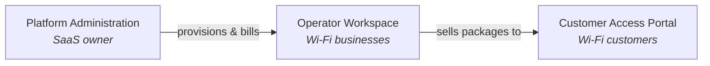
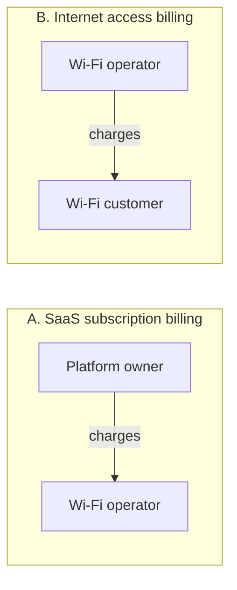
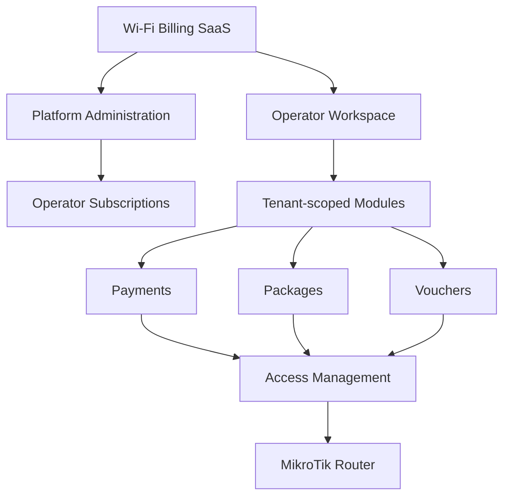
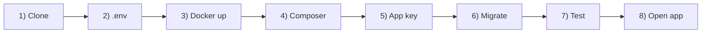
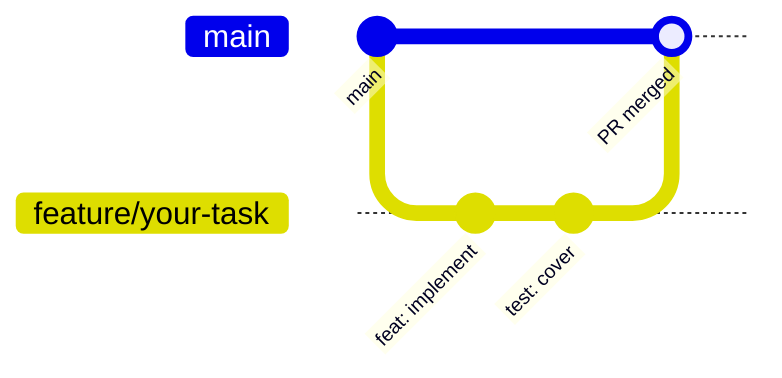
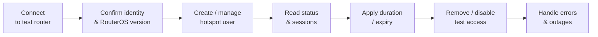
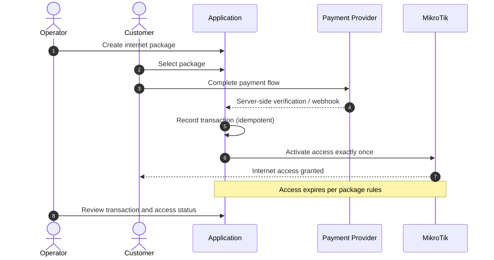
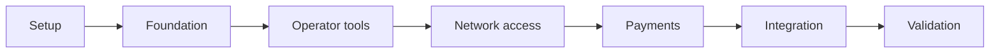

# Wi-Fi Billing SaaS — README (v2)

Below is a revised, production-minded README. It keeps your original structure and tone, but fixes the gaps we identified: **filled-in technology stack**, **concrete decisions**, **bootstrap artifacts**, **clear multi-tenancy strategy**, **payment provider choice**, **MikroTik specifics**, **CI/testing setup**, and a **tightened 14-day plan**. Copy-paste this directly into `README.md`.

---

```markdown
# Wi-Fi Billing SaaS

### A multi-tenant platform for managing Wi-Fi operators, MikroTik hotspots, internet packages, vouchers, customer payments, and operator subscriptions.

**Overview** · **Vision** · **MVP** · **Architecture** · **Getting Started** · **Security** · **Roadmap**

---

**Development status:** Initial setup stage. Features described in this document are **planned** unless their implementation and tests have been verified. See [Roadmap](#17-project-roadmap) for current phase.

---

## Table of Contents

| # | Section | # | Section |
|---|---------|---|---------|
| 1 | Project Overview | 11 | Coding Standards |
| 2 | Product Vision | 12 | Security Requirements |
| 3 | MVP Scope | 13 | MikroTik Integration |
| 4 | Architecture | 14 | Testing and QA |
| 5 | Technology Stack | 15 | Definition of Done |
| 6 | Development Environment | 16 | Troubleshooting |
| 7 | Getting Started | 17 | Project Roadmap |
| 8 | Environment Configuration | 18 | Contributing |
| 9 | Database Workflow | 19 | License |
| 10 | Git and GitHub Collaboration | 20 | Key Decisions Log |

---

## 1. Project Overview

**Wi-Fi Billing SaaS** is a web-based platform that enables internet service providers, hotspot operators, and Wi-Fi businesses to manage their operations from one system.

The platform provides a branded, subscription-based service that serves multiple independent operators while keeping their business data isolated.

### The problem we want to solve

Wi-Fi operators need a reliable way to:

- Manage internet packages and pricing
- Generate and administer access vouchers
- Control customer access through MikroTik routers
- Accept and verify customer payments
- Track active sessions, usage, expirations, and sales
- Manage their business through a centralized dashboard

The platform owner also needs tools to manage operator accounts and charge operators for using the SaaS.

### Project objectives

1. Build a working Wi-Fi billing MVP within an initial **14-day** development window.
2. Establish secure multi-tenant foundations from the beginning.
3. Integrate with a physical MikroTik test router.
4. Implement a verifiable customer payment-to-access workflow.
5. Make the codebase maintainable and extensible for future commercial use.

---

## 2. Product Vision

The long-term product has **three main areas**.



### Platform Administration

The platform owner manages the SaaS itself.

- Operator onboarding and account management
- Operator subscription plans and statuses
- Subscription billing records
- Tenant provisioning and account suspension
- Platform-level operational monitoring

### Operator Workspace

Each operator receives an isolated workspace.

- Dashboard and sales summaries
- Packages and pricing
- Customers and vouchers
- MikroTik router configuration
- Payments and transaction history
- Session and access management
- Operator staff and permissions

### Customer Access Portal

Customers use a responsive portal to get online.

- View available internet packages
- Select a package
- Complete the supported payment flow
- Receive or activate access credentials
- View clear payment and connection status

These are product goals, not a claim that every module is already implemented.

---

## 3. MVP Scope

The first milestone prioritizes a **complete, testable customer journey** over a large collection of unfinished features.

### Target MVP features

| Module | Initial objective |
|--------|-------------------|
| **Authentication** | Secure access for authorized users |
| **Tenant management** | Create and isolate operator accounts |
| **Operator subscriptions** | Store plans, status, and billing records; manual administration initially |
| **Packages** | Configure internet access packages |
| **Vouchers** | Generate and manage vouchers |
| **MikroTik** | Connect to and manage a supported test router |
| **Customer portal** | Select a package and initiate access |
| **Payments** | Integrate one payment provider using its supported test environment |
| **Access activation** | Verify payment before granting access |
| **Sessions** | Track relevant access status and expiration |
| **Dashboard** | Show essential operational records and summaries |
| **Deployment** | Run the application in a documented environment |

### Explicitly deferred unless time permits

- Automated SaaS subscription renewals and suspension
- Multiple payment gateways
- Advanced reseller and agent hierarchies
- Complex multi-router orchestration
- Advanced analytics and custom reporting
- Native mobile applications
- High-availability production infrastructure

### Two distinct billing flows

The system must keep these financial flows **separate**.



| | **A. SaaS subscription billing** | **B. Internet access billing** |
|---|---|---|
| **Who charges** | Platform owner | Operator |
| **Who pays** | Wi-Fi operators | Wi-Fi customers |
| **What is sold** | Access to the management platform | Internet packages |

They have different customers, business rules, records, and lifecycle states. They must **not** be treated as the same subscription or payment.

---

## 4. Architecture

The initial architecture is a **Laravel modular monolith**.

This keeps development and deployment manageable for a two-person team while allowing business modules to remain logically separated.



### Core architectural principles

| Principle | Meaning |
|-----------|---------|
| **Tenant isolation** | Every tenant-owned record must be accessed within the authorized tenant context. |
| **Server-side authorization** | Hiding a UI element is not a security control. |
| **Separation of concerns** | Controllers, services, persistence, and integrations have clear responsibilities. |
| **Reliable payments** | A browser redirect is never proof of payment. |
| **Idempotency** | Repeated payment callbacks must not activate the same purchase twice. |
| **Extensible integrations** | Router and payment integrations are isolated behind interfaces. |
| **Auditability** | Important financial, access-control, and administrative actions are traceable. |

### Multi-tenancy strategy (decided)

**Single database, shared schema, `tenant_id` scoping.**

Rationale:

- Simpler to operate, back up, and migrate for a 2-person team.
- Adequate isolation when enforced by a global Eloquent scope + explicit authorization policies + tests.
- Database-per-tenant can be revisited post-MVP if commercial requirements demand it.

**Enforcement rules:**

1. Every tenant-owned table has a non-nullable `tenant_id` foreign key.
2. A `TenantScope` global Eloquent scope automatically filters reads by the resolved current tenant.
3. The current tenant is resolved from the authenticated user's `tenant_id` **and** middleware — never from a submitted request field.
4. Platform admins use a separate code path with explicit authorization, never by simply omitting the scope.
5. **Automated tests must prove** cross-tenant access attempts fail. Non-negotiable for Definition of Done.

### Module layout

```
app/
├── Domain/                    # Business logic (framework-light)
│   ├── Tenancy/
│   ├── Packages/
│   ├── Vouchers/
│   ├── Payments/
│   ├── Access/
│   └── Subscriptions/
├── Integrations/              # External services behind interfaces
│   ├── MikroTik/
│   └── Payments/
├── Http/                      # Controllers, middleware, requests
│   ├── Controllers/
│   │   ├── Platform/          # SaaS-owner-facing
│   │   ├── Operator/          # Operator-workspace-facing
│   │   └── Customer/          # Customer-portal-facing
│   └── Middleware/
├── Models/
└── Policies/
```

---

## 5. Technology Stack

All versions must be pinned in `composer.json`, `package.json`, and Dockerfiles.

| Component | Technology | Pinned version |
|-----------|-----------|----------------|
| **Backend framework** | Laravel (PHP 8.3+) | Laravel 11.x |
| **Language** | PHP | 8.3 |
| **Frontend** | Blade + Livewire + Alpine.js + Tailwind CSS | Tailwind 3.x |
| **Database** | MySQL | 8.0 |
| **Cache / queue** | Redis | 7.x |
| **Local development** | Docker Desktop (Windows) / Docker Engine (Linux) + Docker Compose | Compose v2 |
| **Source control** | Git + GitHub | — |
| **Router integration** | `evilfreelancer/routeros-api-php` (RouterOS 6/7 API) | Latest stable at lock time |
| **Payment integration** | Provider TBD (see §20) — sandbox only for MVP | — |
| **Automated testing** | Pest (on top of PHPUnit) | Pest 2.x |
| **Continuous integration** | GitHub Actions (test + lint on PR) | — |
| **API testing** | Postman / Bruno collection committed in `docs/api/` | — |
| **Code editor** | VS Code (PHP Intelephense, Docker, EditorConfig, Laravel Blade, Tailwind CSS IntelliSense) | — |
| **Static analysis** | Laravel Pint (formatting) + PHPStan (level 6) | — |

**Why a modular monolith?** One deployable application, one codebase, fewer infrastructure dependencies. Better starting point for the initial deadline than multiple independently deployed services.

**Why Blade + Livewire (not an SPA)?** Fastest path to a working, testable, tenant-scoped UI with Laravel conventions, without maintaining a separate frontend build. It can be swapped for Inertia/Vue later if needed.

---

## 6. Development Environment

The team currently uses two development machines:

| Windows machine | Linux machine |
|-----------------|---------------|
| Docker Desktop + WSL 2 | Docker Engine + Compose plugin |

Both developers must be able to run the project through Docker Compose using the same repository configuration.

### Required software

- Git
- Docker and Docker Compose
- Visual Studio Code (or another compatible editor)
- A GitHub account with repository access
- A modern web browser

### Verify your installation

```bash
git --version
docker --version
docker compose version
docker run --rm hello-world
```

All commands should complete successfully before proceeding.

### Windows developers

Docker Desktop with WSL 2 is the recommended option. Keep the project inside the Linux filesystem when developing through WSL. Follow one consistent workflow rather than mixing Windows-native and Linux tooling unpredictably.

### Linux developers

Install Docker Engine and the Compose plugin for your distribution. Confirm your user can run Docker commands without permission errors. Follow your distribution's security guidance when configuring Docker access.

**Cross-platform rule:** The repository's README and Docker configuration — not an individual developer's machine — define how the application runs. Do not rely on manually installed local PHP or MySQL versions for the shared application environment.

---

## 7. Getting Started



### Step 1: Clone the repository

```bash
git clone https://github.com/VU-Kevin-coder/wifi-billing-saas.git
cd wifi-billing-saas
```

### Step 2: Create the environment file

```bash
cp .env.example .env
```

On PowerShell:

```powershell
Copy-Item .env.example .env
```

The `.env` file contains machine-specific settings and **must not be committed**.

### Step 3: Build and start the containers

```bash
docker compose up -d --build
docker compose ps
```

Review logs if a service fails:

```bash
docker compose logs --tail=100
```

### Step 4: Install PHP dependencies

```bash
docker compose exec app composer install
```

### Step 5: Generate the Laravel application key

```bash
docker compose exec app php artisan key:generate
```

### Step 6: Run database migrations

```bash
docker compose exec app php artisan migrate
```

Seeders are only run when implemented and documented:

```bash
docker compose exec app php artisan db:seed
```

### Step 7: Run the tests

```bash
docker compose exec app php artisan test
```

### Step 8: Open the application

Default local URL: **http://localhost:8000** (confirmed once `docker-compose.yml` is committed).

### Stopping the environment

```bash
docker compose down
```

This stops containers but normally preserves named database volumes.

To delete development database volumes (**destructive**):

```bash
docker compose down -v
```

This can **permanently delete** local database data. Never run it against an environment containing data you need to preserve.

---

## 8. Environment Configuration

`.env.example` documents the required configuration without exposing secrets.

```env
APP_NAME="Wi-Fi Billing SaaS"
APP_ENV=local
APP_DEBUG=true
APP_URL=http://localhost:8000

DB_CONNECTION=mysql
DB_HOST=db
DB_PORT=3306
DB_DATABASE=wifi_billing
DB_USERNAME=wifi_app
DB_PASSWORD=replace_with_local_password

REDIS_HOST=redis
REDIS_PORT=6379

QUEUE_CONNECTION=redis
SESSION_DRIVER=database
CACHE_STORE=redis

# MikroTik (local sandbox only — never commit real credentials)
MIKROTIK_HOST=
MIKROTIK_PORT=8728
MIKROTIK_USERNAME=
MIKROTIK_PASSWORD=
MIKROTIK_USE_SSL=false

# Payment provider (sandbox only — never commit real credentials)
PAYMENT_PROVIDER=
PAYMENT_BASE_URL=
PAYMENT_API_KEY=
PAYMENT_WEBHOOK_SECRET=
```

These are illustrative. The final settings must match the service names, credentials, and ports defined by the actual Compose configuration.

### Rules for environment variables

- `.env` must remain untracked (enforced by `.gitignore`).
- `.env.example` contains placeholders, never real credentials.
- Production settings must be configured separately from development.
- Do not use production router credentials or payment secrets locally.
- Never enable Laravel debug mode in production.
- Rotate any secret that is accidentally committed.

---

## 9. Database Workflow

Database structure is managed through **Laravel migrations**.

| Task | Command |
|------|---------|
| Create a migration | `docker compose exec app php artisan make:migration create_example_table` |
| Run migrations | `docker compose exec app php artisan migrate` |
| Check status | `docker compose exec app php artisan migrate:status` |
| Rollback last batch | `docker compose exec app php artisan migrate:rollback` |

### Migration rules

1. Commit migrations with the feature that requires them.
2. Do not manually edit a shared database schema without documenting the change.
3. Coordinate changes affecting shared tables, relationships, or tenant ownership.
4. Do not modify an already-shared migration to hide a schema change; create a new migration.
5. Test migrations against a clean development database.
6. Never use destructive reset commands on production.

### Tenant ownership

Every tenant-owned table must have a documented ownership and authorization strategy. Foreign keys are useful but do not replace tenant-scoped authorization.

---

## 10. Git and GitHub Collaboration

GitHub is the authoritative location for source code, issues, reviews, and technical decisions. Repository: `VU-Kevin-coder/wifi-billing-saas`.

### Branch strategy

| Branch | Purpose |
|--------|---------|
| `main` | Stable, reviewed code |
| `feature/<name>` | New functionality |
| `fix/<name>` | Bug fixes |
| `docs/<name>` | Documentation changes |
| `test/<name>` | Testing-only changes |

Examples:

```
feature/operator-management
feature/voucher-generation
feature/mikrotik-adapter
fix/payment-callback
docs/development-setup
```

### Standard workflow



Start each task from the latest `main`:

```bash
git switch main
git pull origin main
git switch -c feature/your-task
```

Implement the task, run relevant tests, review the changed files, then:

```bash
git add .
git commit -m "feat: add operator management"
git push -u origin feature/your-task
```

Open a pull request on GitHub. After review and successful CI, merge and update local `main`.

### Commit message conventions

```
feat: add voucher generation
fix: prevent duplicate payment activation
docs: document local Docker setup
test: cover tenant isolation
refactor: separate router integration service
chore: bump laravel/pint to 1.18
```

### Pull request requirements

Every PR should explain:

- [ ] What changed
- [ ] Why the change was needed
- [ ] How it was tested
- [ ] Whether database migrations are included
- [ ] Whether environment variables or documentation changed
- [ ] Any security implications or known limitations

Keep PRs focused. Avoid combining unrelated features, large formatting changes, and database redesigns.

### Resolving merge conflicts

1. Commit or safely stash your local work.
2. Update your branch with the latest base branch.
3. Resolve conflicting files deliberately.
4. Check the resulting diff.
5. Run the affected tests.
6. Push the resolved branch and update the PR.

Do not blindly accept all changes from one side of a conflict.

### Repository protections (recommended)

- Prevent direct pushes to `main`.
- Require pull requests.
- Require successful CI checks before merging.
- Require review where practical.
- Restrict force pushes and branch deletion on `main`.

---

## 11. Coding Standards

### General rules

- Use descriptive names for classes, methods, variables, and database columns.
- Keep controllers focused on HTTP handling.
- Move reusable business logic into domain services.
- Validate incoming data on the server.
- Use Laravel authorization policies (or equivalent) for centralized authorization.
- Prefer dependency injection over hidden global dependencies.
- Avoid duplicate implementations of the same business rule.
- Document non-obvious design decisions.
- Use Laravel conventions unless there is a documented reason not to.

### Formatting & static analysis

- **Laravel Pint** enforces style: `docker compose exec app ./vendor/bin/pint`
- **PHPStan** (level 6, eventually 8) runs in CI: `docker compose exec app ./vendor/bin/phpstan analyse`

### Database and tenant rules

- Define relationships explicitly.
- Add appropriate indexes and constraints.
- Use transactions for operations that must succeed or fail together.
- Enforce tenant ownership when reading, updating, and deleting tenant-owned records.
- **Test attempts to access another tenant's records.** Cross-tenant tests are mandatory.
- Do not assume that an ID supplied by the browser belongs to the authenticated user's tenant.

### External integrations

Router and payment-provider code is separated from core business logic behind interfaces:

```php
namespace App\Integrations\MikroTik;

interface HotspotClient
{
    public function createUser(string $username, string $password, array $profile): void;
    public function disableUser(string $username): void;
    public function getActiveSession(string $username): ?array;
}

namespace App\Integrations\Payments;

interface PaymentProvider
{
    public function createCheckout(array $payload): array;
    public function verifyWebhook(array $headers, string $body): array;
    public function queryStatus(string $reference): string;
}
```

The application must not depend on a specific provider's response shape across every controller.

---

## 12. Security Requirements

Security is a core requirement — the platform will handle financial records, router credentials, and multiple independent businesses.

### Authentication and authorization

- Enforce authorization on the server for every protected action.
- Apply role-based permissions where required.
- Validate tenant membership for tenant-scoped operations.
- Protect sensitive administrative actions.
- Record important security and financial events.

### Multi-tenant isolation

- Scope database access to the authorized tenant via global scopes.
- Check tenant ownership on nested resources and API requests.
- Isolate background jobs, exports, searches, and reports.
- Never trust a submitted `tenant_id` as proof of authorization.
- **Automated tests for cross-tenant access attempts are mandatory.**

### Payment security

- Verify payment status using a trusted server-side verification mechanism.
- Validate webhook signatures per the provider's documentation.
- Handle repeated callbacks safely (idempotency keys, unique transaction references).
- Record transaction references and prevent duplicate fulfillment.
- Do not activate internet access merely because a browser returns to a success URL.
- Never store mobile money PINs or payment-provider secret keys in application records.

### Router security

- Do not expose the RouterOS API directly to the public internet.
- Use a restricted test account.
- Limit management access to a trusted network or VPN.
- Protect router credentials and avoid logging them.
- Never run unapproved tests against a production router.

### Production security checklist (pre-launch)

- [ ] HTTPS enforced
- [ ] Secure, HTTP-only cookies
- [ ] Debug mode off
- [ ] Secret management (env / vault)
- [ ] Database access restricted
- [ ] Backup recovery tested
- [ ] Dependency updates scheduled
- [ ] Monitoring and alerting configured

---

## 13. MikroTik Integration

MikroTik integration is a **critical part** of the product.

Development begins with an isolated test setup and a clearly supported router configuration.

### Supported test hardware (MVP)

- **Router:** MikroTik hAP ac² (or equivalent with hotspot support)
- **RouterOS:** 7.x
- **Connection method:** RouterOS API on port 8728 (plain, on trusted LAN/VPN) or 8729 (API-SSL)
- **Account:** Dedicated restricted hotspot API user, not `admin`

### Initial integration goals



1. Establish authenticated connectivity to the test router.
2. Confirm the router identity and RouterOS version.
3. Create or manage a test hotspot user.
4. Read the user's status and relevant session information.
5. Apply the supported access duration or expiration behavior.
6. Remove or disable test access safely.
7. Handle network errors and unavailable routers without corrupting billing records.

### Integration principles

- Keep RouterOS-specific code behind `App\Integrations\MikroTik\*`.
- Set connection timeouts and handle failures explicitly.
- Do not assume that a successful API request means a customer has working internet.
- Reconcile local access records with router state where appropriate.
- Test expiration, repeated requests, router outages, and recovery.
- Preserve a rollback path for all router configuration changes.

The first release supports a clearly defined configuration rather than attempting to support every MikroTik deployment immediately.

---

## 14. Testing and QA

Testing happens **throughout development**, not only at the end of the two-week period.

### Minimum test categories

| Category | What to verify |
|----------|----------------|
| **Unit tests** | Business rules and calculations |
| **Feature tests** | HTTP requests and application behavior |
| **Authorization tests** | Roles and permissions |
| **Tenant isolation tests** | One operator cannot access another's data |
| **Payment tests** | Verification, failures, duplicates, and retries |
| **Router integration tests** | Connectivity, errors, and access lifecycle (mocked) |
| **Migration tests** | Schema creation and clean setup |
| **Acceptance tests** | Complete customer purchase-to-access flow |

### Essential end-to-end scenario



1. An operator has an active account.
2. The operator creates an internet package.
3. A customer selects that package.
4. The customer completes the supported payment flow.
5. The server verifies the payment.
6. The application records the successful transaction.
7. The system activates the corresponding access **exactly once**.
8. The customer's access expires according to the package rules.
9. The operator can review the transaction and access status.

Use test credentials and a sandbox provider during development. A mocked router or payment service can support automated tests, but does not replace physical-router and provider-sandbox acceptance testing.

### CI (GitHub Actions)

Every PR runs:

- `composer install --no-interaction`
- `./vendor/bin/pint --test`
- `./vendor/bin/phpstan analyse`
- `php artisan test`

Merging is blocked if any step fails.

---

## 15. Definition of Done

A task is not complete merely because its interface looks correct.

A task is done when:

- [ ] Agreed acceptance criteria are satisfied
- [ ] Implementation follows project conventions
- [ ] Relevant automated tests pass
- [ ] Authorization and tenant boundaries are verified where applicable
- [ ] Database changes use migrations
- [ ] Errors are handled appropriately
- [ ] No secrets or real customer data have been committed
- [ ] Documentation is updated where needed
- [ ] Pull request has been reviewed
- [ ] Change has been merged through the agreed workflow

---

## 16. Troubleshooting

**Docker service is not starting**

```bash
docker compose ps
docker compose logs --tail=100
```

Check that Docker is running, ports are available, and the configuration is valid.

**The application cannot connect to MySQL**

Check that:

- The database container is healthy.
- `DB_HOST` matches the Compose database service name.
- Database credentials match the configured development credentials.
- The database has completed initialization.

Inside Docker, `localhost` normally refers to the current container, not another service.

**Laravel reports a missing application key**

After creating the local `.env` file:

```bash
docker compose exec app php artisan key:generate
```

Do not replace a shared or production application key casually.

**Database migrations fail**

```bash
docker compose exec app php artisan migrate:status
docker compose logs --tail=100
```

Inspect the actual database error and check whether the migration has already run. Avoid destructive reset commands until the data impact is understood.

**Git says there are merge conflicts**

```bash
git status
```

Open the conflicting files, resolve deliberately, then stage and commit. Run affected tests before pushing.

**MikroTik connectivity fails**

Check network reachability, the router address, API service configuration, account permissions, firewall rules, and RouterOS version. Do not solve connectivity problems by exposing the router API publicly.

---

## 17. Project Roadmap

The initial development target is **14 days**. Dates and scope may change if testing reveals significant integration issues.



| Days | Phase | Focus | Status |
|------|-------|-------|--------|
| 1–2 | **Setup** | Repo, Docker, CI, `.env.example`, base schema | ⏳ |
| 3–4 | **Foundation** | Auth, tenant model, authorization policies, cross-tenant tests | ⏳ |
| 5–6 | **Operator tools** | Packages, vouchers, essential dashboard (tenant-scoped) | ⏳ |
| 7–8 | **Network access** | MikroTik adapter, hotspot user lifecycle, mocked tests | ⏳ |
| 9–10 | **Payments** | Provider sandbox, webhook verification, idempotent fulfillment | ⏳ |
| 11–12 | **Integration** | Customer portal, end-to-end purchase → access flow | ⏳ |
| 13 | **Polish** | Operator subscription records (manual), dashboard summaries | ⏳ |
| 14 | **Validation** | Automated tests, acceptance testing, deployment, handover | ⏳ |

> Update the status column (`⏳ pending`, `🟡 in progress`, `✅ done`) as phases complete.

### Initial milestone

Deliver a working demonstration in which **one operator can manage a supported MikroTik hotspot, sell an internet package, and activate customer access through a verified payment flow.**

The platform must also demonstrate isolation between **at least two test operators**.

### Risk note

The two highest-risk deliverables are **payment integration** and **MikroTik integration**. Both must have a working "hello world" (dummy webhook received; dummy hotspot user created) **by day 8**, before any UI is built around them.

---

## 18. Contributing

This is a collaborative project maintained by **two developers**.

Before beginning a task:

1. Read this README and the relevant issue.
2. Update your local `main` branch.
3. Create a dedicated feature branch.
4. Confirm the expected behavior and interfaces.
5. Implement and test your changes.
6. Open a pull request with a clear description.

If a decision affects shared architecture, database structure, security, payment handling, or router integration, **discuss it with the other developer before implementing it**.

Record significant decisions in GitHub Issues and in the **Key Decisions Log** (§20).

### Working agreement

- Communicate blockers early.
- Keep changes small and reviewable.
- Do not overwrite another developer's work.
- Never commit secrets.
- Prefer tested behavior over rushed, unverified code.
- Update documentation when the actual workflow changes.

---

## 19. License

No open-source license has been selected yet.

Until the project owners decide otherwise, this is a private repository. Do not redistribute or publish its code without authorization from the project owners.

---

## 20. Key Decisions Log

Record significant architectural decisions here as they are made. Each entry should state the decision, the date, and the rationale.

| # | Decision | Rationale | Date |
|---|----------|-----------|------|
| 1 | Modular monolith (Laravel) | Fits 2-person team, 14-day deadline | 2026-10-24 |
| 2 | Multi-tenancy: single DB, shared schema, `tenant_id` | Simpler ops; adequate isolation when tested | 2026-10-24 |
| 3 | Frontend: Blade + Livewire + Alpine + Tailwind | Fastest path to working tenant-scoped UI | 2026-10-24 |
| 4 | Payment provider: **TBD** | Must be decided before day 9 | — |
| 5 | MikroTik target: hAP ac², RouterOS 7.x | Available test hardware; RouterOS 7 is current | 2026-10-24 |

---

**Built with the goal of making Wi-Fi operations easier to manage, safer to scale, and ready for a multi-operator SaaS business.**

[Back to top](#wi-fi-billing-saas)
```

