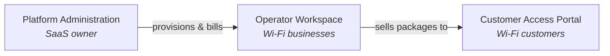
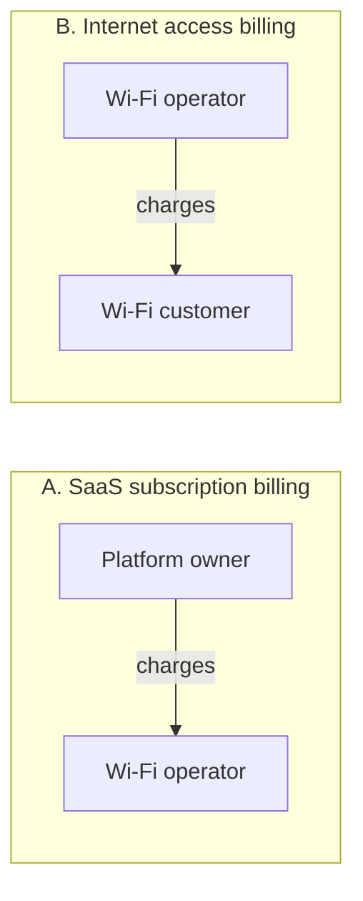
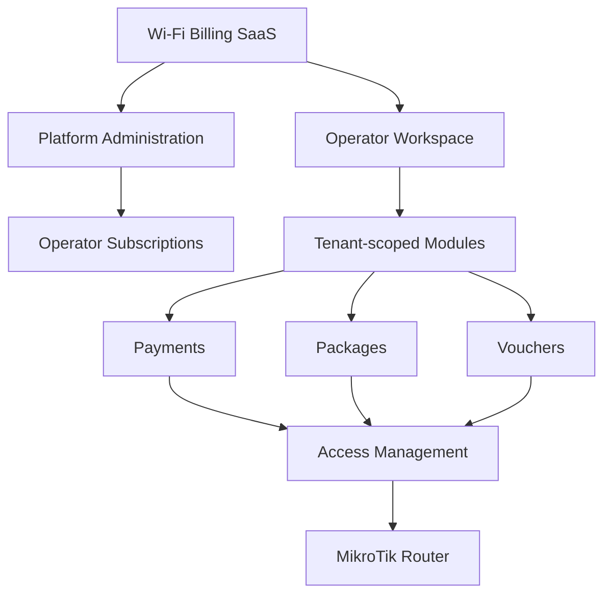
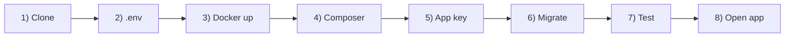
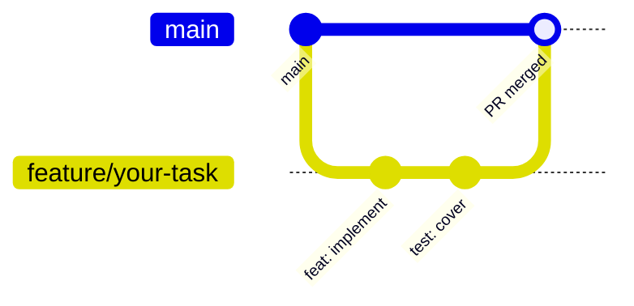
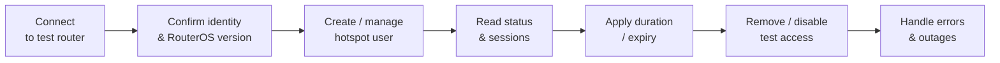
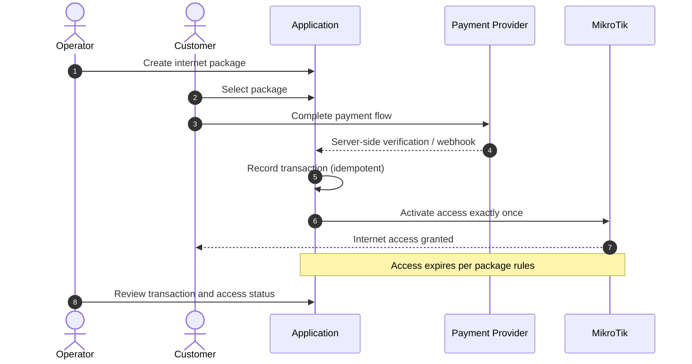
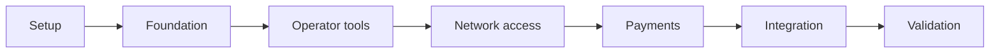

<div align="center">

# Wi-Fi Billing SaaS

### A multi-tenant platform for managing Wi-Fi operators, MikroTik hotspots, internet packages, vouchers, customer payments, and operator subscriptions.

<br>

[](https://github.com/VU-Kevin-coder/wifi-billing-saas)
[](https://github.com/VU-Kevin-coder/wifi-billing-saas/issues)
[](https://github.com/VU-Kevin-coder/wifi-billing-saas/pulls)
[](https://github.com/VU-Kevin-coder/wifi-billing-saas/actions)


<br>

[**Overview**](#1-project-overview) ·
[**Vision**](#2-product-vision) ·
[**MVP**](#3-mvp-scope) ·
[**Architecture**](#4-architecture) ·
[**Getting Started**](#7-getting-started) ·
[**Security**](#12-security-requirements) ·
[**Roadmap**](#17-project-roadmap)

</div>

---

> [!IMPORTANT]
> **Development status:** This repository is in its initial setup stage. Features described in this document are **planned** unless their implementation and tests have been verified.

---

## Table of Contents

| # | Section | # | Section |
|:-:|---|:-:|---|
| 1 | [Project Overview](#1-project-overview) | 11 | [Coding Standards](#11-coding-standards) |
| 2 | [Product Vision](#2-product-vision) | 12 | [Security Requirements](#12-security-requirements) |
| 3 | [MVP Scope](#3-mvp-scope) | 13 | [MikroTik Integration](#13-mikrotik-integration) |
| 4 | [Architecture](#4-architecture) | 14 | [Testing and QA](#14-testing-and-quality-assurance) |
| 5 | [Technology Stack](#5-technology-stack) | 15 | [Definition of Done](#15-definition-of-done) |
| 6 | [Development Environment](#6-development-environment) | 16 | [Troubleshooting](#16-troubleshooting) |
| 7 | [Getting Started](#7-getting-started) | 17 | [Project Roadmap](#17-project-roadmap) |
| 8 | [Environment Configuration](#8-environment-configuration) | 18 | [Contributing](#18-contributing) |
| 9 | [Database Workflow](#9-database-workflow) | 19 | [License](#19-license) |
| 10 | [Git and GitHub Collaboration](#10-git-and-github-collaboration) | | |

---

## 1. Project Overview

**Wi-Fi Billing SaaS** is a planned web-based platform that enables internet service providers, hotspot operators, and Wi-Fi businesses to manage their operations from one system.

The platform is intended to provide a branded, subscription-based service that can serve multiple independent operators while keeping their business data isolated.

### The problem we want to solve

Wi-Fi operators need a reliable way to:

- Manage internet packages and pricing
- Generate and administer access vouchers
- Control customer access through MikroTik routers
- Accept and verify customer payments
- Track active sessions, usage, expirations, and sales
- Manage their business through a centralized dashboard

The platform owner also needs tools to manage operator accounts and charge operators for using the SaaS.

### Project objectives

1. Build a working Wi-Fi billing MVP within an initial **14-day** development window.
2. Establish secure multi-tenant foundations from the beginning.
3. Integrate with a physical MikroTik test router.
4. Implement a verifiable customer payment-to-access workflow.
5. Make the codebase maintainable and extensible for future commercial use.

---

## 2. Product Vision

The long-term product will have **three main areas**.



<table>
<tr>
<td width="33%" valign="top">

### Platform Administration

The platform owner manages the SaaS itself.

- Operator onboarding and account management
- Operator subscription plans and statuses
- Subscription billing records
- Tenant provisioning and account suspension
- Platform-level operational monitoring

</td>
<td width="33%" valign="top">

### Operator Workspace

Each operator receives an isolated workspace.

- Dashboard and sales summaries
- Packages and pricing
- Customers and vouchers
- MikroTik router configuration
- Payments and transaction history
- Session and access management
- Operator staff and permissions

</td>
<td width="33%" valign="top">

### Customer Access Portal

Customers use a responsive portal to get online.

- View available internet packages
- Select a package
- Complete the supported payment flow
- Receive or activate access credentials
- View clear payment and connection status

</td>
</tr>
</table>

> [!NOTE]
> These are product goals, not a claim that every module is already implemented.

---

## 3. MVP Scope

The first milestone prioritizes a **complete, testable customer journey** over a large collection of unfinished features.

### Target MVP features

| Module | Initial objective |
|---|---|
| **Authentication** | Secure access for authorized users |
| **Tenant management** | Create and isolate operator accounts |
| **Operator subscriptions** | Store plans, status, and billing records; manual administration initially |
| **Packages** | Configure internet access packages |
| **Vouchers** | Generate and manage vouchers |
| **MikroTik** | Connect to and manage a supported test router |
| **Customer portal** | Select a package and initiate access |
| **Payments** | Integrate one payment provider using its supported test environment |
| **Access activation** | Verify payment before granting access |
| **Sessions** | Track relevant access status and expiration |
| **Dashboard** | Show essential operational records and summaries |
| **Deployment** | Run the application in a documented environment |

<details>
<summary><b>Explicitly deferred unless time permits</b></summary>

<br>

- Automated SaaS subscription renewals and suspension
- Multiple payment gateways
- Advanced reseller and agent hierarchies
- Complex multi-router orchestration
- Advanced analytics and custom reporting
- Native mobile applications
- High-availability production infrastructure

</details>

### Two distinct billing flows

The system must keep these financial flows **separate**.



| | **A. SaaS subscription billing** | **B. Internet access billing** |
|---|---|---|
| **Who charges** | Platform owner | Operator |
| **Who pays** | Wi-Fi operators | Wi-Fi customers |
| **What is sold** | Access to the management platform | Internet packages |

> [!WARNING]
> They have different customers, business rules, records, and lifecycle states. They must **not** be treated as the same subscription or payment.

---

## 4. Architecture

The initial architecture is a **Laravel modular monolith**.

This keeps development and deployment manageable for a two-person team while allowing business modules to remain logically separated.



### Core architectural principles

| Principle | Meaning |
|---|---|
| **Tenant isolation** | Every tenant-owned record must be accessed within the authorized tenant context. |
| **Server-side authorization** | Hiding a user interface element is not a security control. |
| **Separation of concerns** | Controllers, business services, persistence, and external integrations should have clear responsibilities. |
| **Reliable payments** | A browser redirect alone must never be treated as proof of payment. |
| **Idempotency** | Repeated payment callbacks or jobs must not activate the same purchase multiple times. |
| **Extensible integrations** | Router and payment integrations should be isolated behind clear interfaces. |
| **Auditability** | Important financial, access-control, and administrative actions should be traceable. |

### Initial tenant model

A single application serves multiple operators.

Each operator's business data must be scoped to the correct tenant. Platform administrators may have explicitly authorized cross-tenant access for administration.

The implementation must define and test tenant ownership for **database queries, APIs, background jobs, reports, exports, and related resources**.

---

## 5. Technology Stack

| Component | Technology |
|---|---|
| **Backend** |   |
| **Frontend** |   |
| **Database** |  |
| **Local development** |  |
| **Source control** |  [](https://github.com/VU-Kevin-coder/wifi-billing-saas) |
| **Router integration** |  |
| **Automated testing** |  |
| **Continuous integration** |  |
| **API testing** |  or an equivalent client |
| **Code editor** |  |

> [!NOTE]
> Exact PHP, Laravel, MySQL, Node.js, and dependency versions must be pinned in the project configuration once the initial application is generated.

<details>
<summary><b>Why a modular monolith?</b></summary>

<br>

It gives the team one deployable application, one primary codebase, and fewer infrastructure dependencies. It is a better starting point for the initial deadline than introducing multiple independently deployed services.

</details>

---

## 6. Development Environment

The team currently uses two development machines:

| Windows machine | Linux machine |
|:-:|:-:|
| Docker Desktop + WSL 2 | Docker Engine + Compose plugin |

Both developers must be able to run the project through Docker Compose using the same repository configuration.

### Required software

-  Git
-  Docker and Docker Compose
-  Visual Studio Code or another compatible editor
-  A GitHub account with repository access
- A modern web browser

Useful VS Code extensions include **PHP Intelephense**, **Docker**, **EditorConfig**, and a Laravel-aware extension.

### Verify your installation

Run the following commands in your terminal:

```bash
git --version
docker --version
docker compose version
docker run --rm hello-world
```

All commands should complete successfully before proceeding.

### Windows developers

Docker Desktop with WSL 2 is a recommended option for Windows development.

If using WSL 2, keep the project inside the Linux filesystem when developing through WSL. Follow one consistent workflow rather than mixing Windows-native and Linux tooling unpredictably.

### Linux developers

Install Docker Engine and the Docker Compose plugin using the instructions for your Linux distribution.

Confirm that your user can run Docker commands without permission errors. Follow your distribution's security guidance when configuring Docker access.

> [!TIP]
> **Cross-platform rule:** The repository's README and Docker configuration, not an individual developer's machine, must define how the application runs. Do not rely on manually installed local PHP or MySQL versions for the shared application environment.

---

## 7. Getting Started

> [!CAUTION]
> **Bootstrap status:** These instructions describe the intended workflow. The Dockerfile, Compose configuration, and Laravel application must exist before the commands can be expected to work.



### Step 1: Clone the repository

The repository is hosted at [VU-Kevin-coder/wifi-billing-saas](https://github.com/VU-Kevin-coder/wifi-billing-saas).

```bash
git clone https://github.com/VU-Kevin-coder/wifi-billing-saas.git
cd wifi-billing-saas
```

### Step 2: Create the environment file

Once `.env.example` has been committed:

```bash
cp .env.example .env
```

On PowerShell, use:

```powershell
Copy-Item .env.example .env
```

The `.env` file contains machine-specific settings and **must not be committed**.

### Step 3: Build and start the containers

After the Compose configuration is implemented:

```bash
docker compose up -d --build
```

Inspect service status:

```bash
docker compose ps
```

Review logs if a service fails:

```bash
docker compose logs --tail=100
```

### Step 4: Install PHP dependencies

The exact service name will be confirmed in `docker-compose.yml`. If the application service is named `app`, use:

```bash
docker compose exec app composer install
```

### Step 5: Generate the Laravel application key

```bash
docker compose exec app php artisan key:generate
```

This assumes the application service can access the local `.env` file and that the Laravel application has been initialized.

### Step 6: Run database migrations

```bash
docker compose exec app php artisan migrate
```

Use seeders only when they have been implemented and documented:

```bash
docker compose exec app php artisan db:seed
```

### Step 7: Run the tests

```bash
docker compose exec app php artisan test
```

### Step 8: Open the application

Use the local URL configured by the Compose setup. The exact port and URL will be documented when the initial Docker configuration is created.

### Stopping the environment

```bash
docker compose down
```

This stops the containers but normally preserves named database volumes.

To delete development database volumes, Docker supports:

```bash
docker compose down -v
```

> [!WARNING]
> This can **permanently delete** local database data. Never run it against an environment containing data you need to preserve.

---

## 8. Environment Configuration

The `.env.example` file should document the configuration required to run the application without exposing secrets.

Typical Laravel settings include:

```dotenv
APP_NAME="Wi-Fi Billing SaaS"
APP_ENV=local
APP_DEBUG=true
APP_URL=http://localhost

DB_CONNECTION=mysql
DB_HOST=db
DB_PORT=3306
DB_DATABASE=wifi_billing
DB_USERNAME=wifi_app
DB_PASSWORD=replace_with_local_password
```

These are illustrative values. The final settings must match the service names, credentials, and ports defined by the actual Compose configuration.

### Rules for environment variables

- [x] `.env` must remain untracked
- [x] `.env.example` contains placeholders, never real credentials
- [x] Production settings must be configured separately from development
- [x] Do not use production router credentials or payment secrets locally
- [x] Never enable Laravel debug mode in production
- [x] Rotate any secret that is accidentally committed

---

## 9. Database Workflow

Database structure must be managed through **Laravel migrations**.

| Task | Command |
|---|---|
| Create a migration | `docker compose exec app php artisan make:migration create_example_table` |
| Run migrations | `docker compose exec app php artisan migrate` |
| Check migration status | `docker compose exec app php artisan migrate:status` |

### Migration rules

1. Commit migrations with the feature that requires them.
2. Do not manually edit a shared database schema without documenting the change.
3. Coordinate changes that affect shared tables, relationships, or tenant ownership.
4. Do not modify an already shared migration to hide a schema change; create a new migration when appropriate.
5. Test migrations against a clean development database.
6. Never use destructive reset commands on production.

> [!IMPORTANT]
> Tenant-owned tables must have an explicitly documented ownership and authorization strategy. Database foreign keys are useful, but they do not replace tenant-scoped authorization.

---

## 10. Git and GitHub Collaboration

GitHub is the authoritative location for source code, issues, reviews, and technical decisions. Repository: [VU-Kevin-coder/wifi-billing-saas](https://github.com/VU-Kevin-coder/wifi-billing-saas).

### Branch strategy

| Branch | Purpose |
|---|---|
| `main` | Stable, reviewed code |
| `feature/<name>` | New functionality |
| `fix/<name>` | Bug fixes |
| `docs/<name>` | Documentation changes |
| `test/<name>` | Testing-only changes |

Examples:

```text
feature/operator-management
feature/voucher-generation
feature/mikrotik-adapter
fix/payment-callback
docs/development-setup
```

### Standard workflow



Start each task from the latest `main` branch:

```bash
git switch main
git pull origin main
git switch -c feature/your-task
```

Implement the task, run relevant tests, and review the changed files.

Commit your work:

```bash
git add .
git commit -m "feat: add operator management"
git push -u origin feature/your-task
```

Then [open a pull request](https://github.com/VU-Kevin-coder/wifi-billing-saas/pulls) on GitHub. After review and successful checks, merge the pull request and update your local `main`.

### Commit message conventions

Use concise, descriptive commit messages:

```text
feat: add voucher generation
fix: prevent duplicate payment activation
docs: document local Docker setup
test: cover tenant isolation
refactor: separate router integration service
```

### Pull request requirements

Every pull request should explain:

- [] What changed
- [] Why the change was needed
- [] How it was tested
- [] Whether database migrations are included
- [] Whether environment variables or documentation changed
- [] Any security implications or known limitations

Keep pull requests focused. Avoid combining unrelated features, large formatting changes, and database redesigns into one review.

### Resolving merge conflicts

1. Commit or safely stash your local work.
2. Update your branch with the latest base branch.
3. Resolve the conflicting files deliberately.
4. Check the resulting diff.
5. Run the affected tests.
6. Push the resolved branch and update the pull request.

> [!WARNING]
> Do not blindly accept all changes from one side of a conflict.

### Suggested repository protections

Configure these through GitHub settings where available:

- Prevent direct pushes to `main`
- Require pull requests
- Require successful CI checks before merging
- Require review where practical
- Restrict force pushes and branch deletion on `main`

---

## 11. Coding Standards

The codebase should remain understandable to both developers.

### General rules

- Use descriptive names for classes, methods, variables, and database columns.
- Keep controllers focused on HTTP handling.
- Move reusable business logic into appropriately named services or domain classes.
- Validate incoming data on the server.
- Use Laravel authorization policies or equivalent centralized authorization.
- Prefer dependency injection over hidden global dependencies.
- Avoid duplicate implementations of the same business rule.
- Document non-obvious design decisions.
- Use Laravel conventions unless there is a documented reason not to.

### Database and tenant rules

- Define relationships explicitly.
- Add appropriate indexes and constraints.
- Use transactions for operations that must succeed or fail together.
- Enforce tenant ownership when reading, updating, and deleting tenant-owned records.
- Test attempts to access another tenant's records.
- Do not assume that an ID supplied by the browser belongs to the authenticated user's tenant.

### External integrations

Router and payment-provider code should be separated from core business logic.

The application should not need to know the details of a specific payment provider or RouterOS API response throughout every controller.

---

## 12. Security Requirements

> [!IMPORTANT]
> Security is a core requirement, especially because the platform will handle financial records, router credentials, and multiple independent businesses.

<table>
<tr>
<td width="50%" valign="top">

### Authentication and authorization

- Enforce authorization on the server for every protected action
- Apply role-based permissions where required
- Validate tenant membership for tenant-scoped operations
- Protect sensitive administrative actions
- Record important security and financial events

### Multi-tenant isolation

- Scope database access to the authorized tenant
- Check tenant ownership on nested resources and API requests
- Isolate background jobs, exports, searches, and reports
- Avoid trusting a submitted `tenant_id` as proof of authorization
- Add automated tests for cross-tenant access attempts

</td>
<td width="50%" valign="top">

### Payment security

- Verify payment status using a trusted server-side verification mechanism
- Validate webhook signatures or authentication per the provider's documentation
- Handle repeated callbacks safely
- Record transaction references and prevent duplicate fulfillment
- Do not activate internet access merely because a browser returns to a success URL
- Never store mobile money PINs or payment-provider secret keys in application records

### Router security

- Do not expose the RouterOS API directly to the public internet
- Use a restricted test account
- Limit management access to a trusted network or VPN
- Protect router credentials and avoid logging them
- Never run unapproved tests against a production router

</td>
</tr>
</table>

### Production security

Before production deployment, verify:

- [] HTTPS
- [] Secure cookies
- [] Debug settings
- [] Secret management
- [] Database access restrictions
- [] Backup recovery
- [] Dependency updates
- [] Monitoring

---

## 13. MikroTik Integration

MikroTik integration is a **critical part** of the product.

Development should begin with an isolated test setup and a clearly supported router configuration.

### Initial integration goals



1. Establish authenticated connectivity to the test router.
2. Confirm the router identity and RouterOS version.
3. Create or manage a test hotspot user.
4. Read the user's status and relevant session information.
5. Apply the supported access duration or expiration behavior.
6. Remove or disable test access safely.
7. Handle network errors and unavailable routers without corrupting billing records.

### Integration principles

- Keep RouterOS-specific code behind a dedicated integration layer.
- Set connection timeouts and handle failures explicitly.
- Do not assume that a successful API request means a customer has working internet.
- Reconcile local access records with router state where appropriate.
- Test expiration, repeated requests, router outages, and recovery.
- Preserve a rollback path for all router configuration changes.

> [!NOTE]
> The first release should support a clearly defined configuration rather than attempting to support every MikroTik deployment immediately.

---

## 14. Testing and Quality Assurance

Testing must happen **throughout development**, not only at the end of the two-week period.

### Minimum test categories

| Category | What to verify |
|---|---|
| **Unit tests** | Business rules and calculations |
| **Feature tests** | HTTP requests and application behavior |
| **Authorization tests** | Roles and permissions |
| **Tenant isolation tests** | One operator cannot access another's data |
| **Payment tests** | Verification, failures, duplicates, and retries |
| **Router integration tests** | Connectivity, errors, and access lifecycle |
| **Migration tests** | Schema creation and clean setup |
| **Acceptance tests** | Complete customer purchase-to-access flow |

### Essential end-to-end scenario



1. An operator has an active account.
2. The operator creates an internet package.
3. A customer selects that package.
4. The customer completes the supported payment flow.
5. The server verifies the payment.
6. The application records the successful transaction.
7. The system activates the corresponding access exactly once.
8. The customer's access expires according to the package rules.
9. The operator can review the transaction and access status.

> [!TIP]
> Use test credentials and a sandbox provider during development. A mocked router or payment service can support automated tests, but it does not replace physical-router and provider-sandbox acceptance testing.

---

## 15. Definition of Done

A task is not complete merely because its interface looks correct.

A task is done when:

- [] The agreed acceptance criteria are satisfied
- [] The implementation follows project conventions
- [] Relevant automated tests pass
- [] Authorization and tenant boundaries are verified where applicable
- [] Database changes use migrations
- [] Errors are handled appropriately
- [] No secrets or real customer data have been committed
- [] Documentation is updated where needed
- [] The pull request has been reviewed
- [] The change has been merged through the agreed workflow

---

## 16. Troubleshooting

<details>
<summary><b>Docker service is not starting</b></summary>

<br>

```bash
docker compose ps
docker compose logs --tail=100
```

Check that Docker is running, ports are available, and the configuration is valid.

</details>

<details>
<summary><b>The application cannot connect to MySQL</b></summary>

<br>

Check that:

- The database container is healthy.
- `DB_HOST` matches the Compose database service name.
- Database credentials match the configured development credentials.
- The database has completed initialization.

Inside Docker, `localhost` normally refers to the current container, not another service.

</details>

<details>
<summary><b>Laravel reports a missing application key</b></summary>

<br>

After creating the local `.env` file, run:

```bash
docker compose exec app php artisan key:generate
```

Do not replace a shared or production application key casually.

</details>

<details>
<summary><b>Database migrations fail</b></summary>

<br>

```bash
docker compose exec app php artisan migrate:status
docker compose logs --tail=100
```

Inspect the actual database error and check whether the migration has already run. Avoid destructive reset commands until the data impact is understood.

</details>

<details>
<summary><b>Git says there are merge conflicts</b></summary>

<br>

```bash
git status
```

Open the conflicting files, resolve the changes deliberately, then stage and commit the resolution. Run the affected tests before pushing.

</details>

<details>
<summary><b>MikroTik connectivity fails</b></summary>

<br>

Check network reachability, the router address, API service configuration, account permissions, firewall rules, and RouterOS version. Do not solve connectivity problems by exposing the router API publicly.

</details>

---

## 17. Project Roadmap

The initial development target is **14 days**. Dates and scope may change if testing reveals significant integration issues.



| Phase | Focus | Status |
|:-:|---|:-:|
| **Setup** | Repository, Docker, collaboration rules and project structure |  |
| **Foundation** | Authentication, tenant model, authorization and database schema |  |
| **Operator tools** | Packages, customers, vouchers and essential dashboard |  |
| **Network access** | MikroTik connectivity and access lifecycle |  |
| **Payments** | Provider sandbox, server-side verification and idempotency |  |
| **Integration** | Customer purchase flow, access activation and expiry |  |
| **Validation** | Automated tests, acceptance testing, deployment and handover |  |

> Update the status column (e.g. `in progress`, `done`) as phases are completed.

### Initial milestone

Deliver a working demonstration in which **one operator can manage a supported MikroTik hotspot, sell an internet package, and activate customer access through a verified payment flow**.

The platform must also demonstrate isolation between **at least two test operators**.

---

## 18. Contributing

This is a collaborative project maintained by **two developers**.

Before beginning a task:

1. Read this README and the relevant issue.
2. Update your local `main` branch.
3. Create a dedicated feature branch.
4. Confirm the expected behavior and interfaces.
5. Implement and test your changes.
6. Open a pull request with a clear description.

If a decision affects shared architecture, database structure, security, payment handling, or router integration, discuss it with the other developer before implementing it.

Record significant decisions in [GitHub Issues](https://github.com/VU-Kevin-coder/wifi-billing-saas/issues) or a dedicated architecture decision document.

### Working agreement

- Communicate blockers early.
- Keep changes small and reviewable.
- Do not overwrite another developer's work.
- Never commit secrets.
- Prefer tested behavior over rushed, unverified code.
- Update documentation when the actual workflow changes.

---

## 19. License


No open-source license has been selected yet.

Until the project owners decide otherwise, this is a private repository. Do not redistribute or publish its code without authorization from the project owners.

---

<div align="center">

**Built with the goal of making Wi-Fi operations easier to manage, safer to scale, and ready for a multi-operator SaaS business.**

<br>


<sub><a href="#wi-fi-billing-saas">Back to top</a></sub>

</div>
