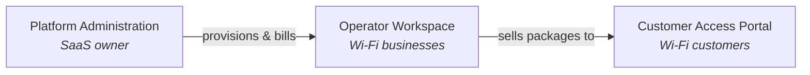
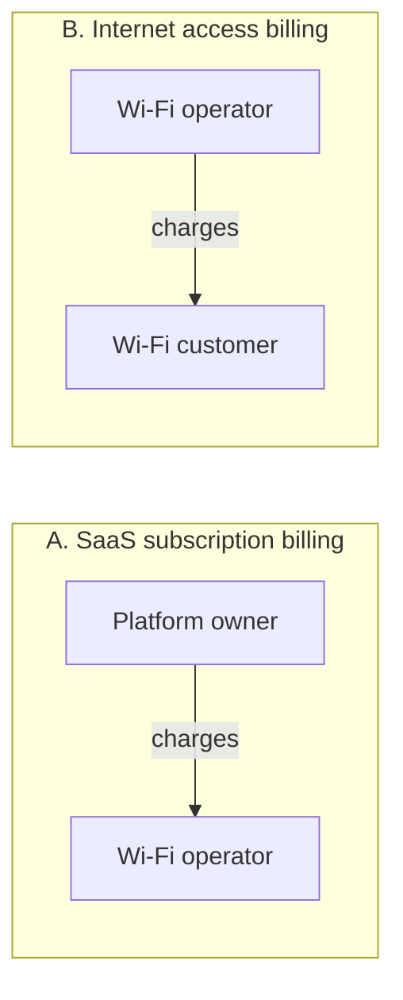
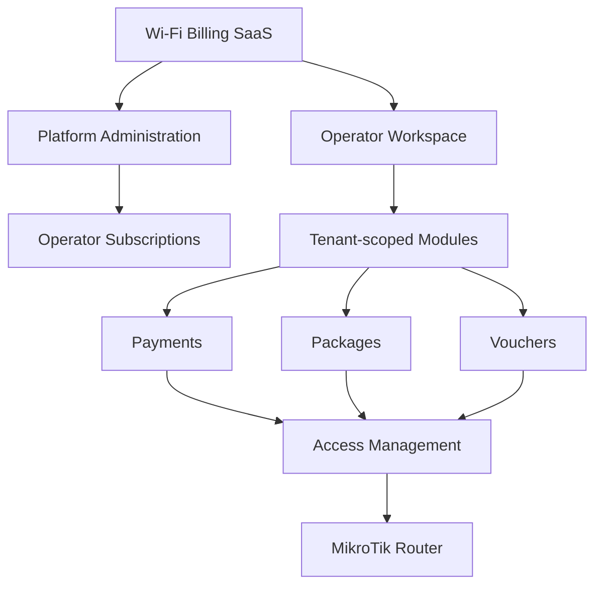
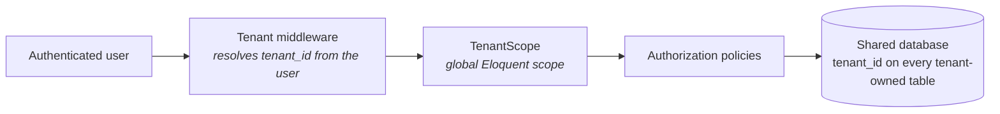
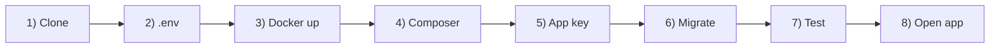
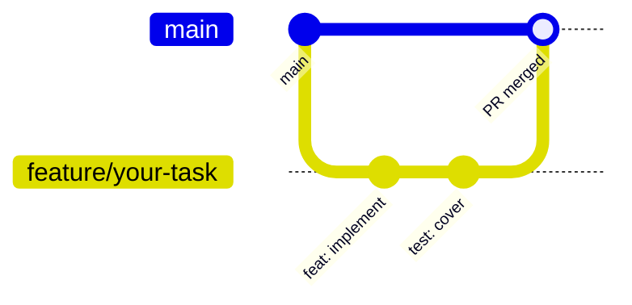
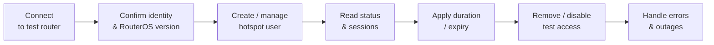
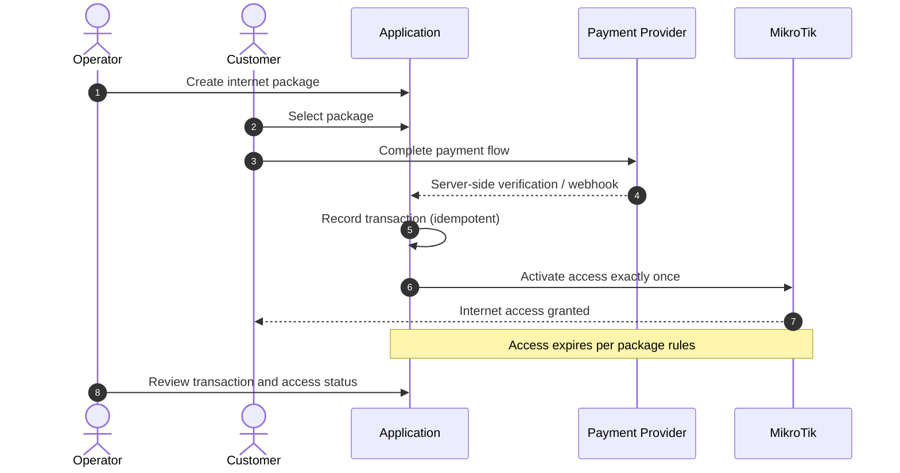
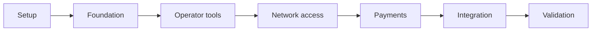

<div align="center">

# Wi-Fi Billing SaaS

### A multi-tenant platform for managing Wi-Fi operators, MikroTik hotspots, internet packages, vouchers, customer payments, and operator subscriptions.

<br>

[](https://github.com/VU-Kevin-coder/wifi-billing-saas)
[](https://github.com/VU-Kevin-coder/wifi-billing-saas/issues)
[](https://github.com/VU-Kevin-coder/wifi-billing-saas/pulls)
[](https://github.com/VU-Kevin-coder/wifi-billing-saas/actions)


<br>

[**Overview**](#1-project-overview) ·
[**Vision**](#2-product-vision) ·
[**MVP**](#3-mvp-scope) ·
[**Architecture**](#4-architecture) ·
[**Getting Started**](#7-getting-started) ·
[**Security**](#12-security-requirements) ·
[**Roadmap**](#17-project-roadmap)

</div>

---

> [!IMPORTANT]
> **Development status:** Initial setup stage. Features described in this document are **planned** unless their implementation and tests have been verified. See the [Roadmap](#17-project-roadmap) for the current phase.

---

## Table of Contents

| # | Section | # | Section |
|:-:|---|:-:|---|
| 1 | [Project Overview](#1-project-overview) | 11 | [Coding Standards](#11-coding-standards) |
| 2 | [Product Vision](#2-product-vision) | 12 | [Security Requirements](#12-security-requirements) |
| 3 | [MVP Scope](#3-mvp-scope) | 13 | [MikroTik Integration](#13-mikrotik-integration) |
| 4 | [Architecture](#4-architecture) | 14 | [Testing and QA](#14-testing-and-qa) |
| 5 | [Technology Stack](#5-technology-stack) | 15 | [Definition of Done](#15-definition-of-done) |
| 6 | [Development Environment](#6-development-environment) | 16 | [Troubleshooting](#16-troubleshooting) |
| 7 | [Getting Started](#7-getting-started) | 17 | [Project Roadmap](#17-project-roadmap) |
| 8 | [Environment Configuration](#8-environment-configuration) | 18 | [Contributing](#18-contributing) |
| 9 | [Database Workflow](#9-database-workflow) | 19 | [License](#19-license) |
| 10 | [Git and GitHub Collaboration](#10-git-and-github-collaboration) | 20 | [Key Decisions Log](#20-key-decisions-log) |

---

## 1. Project Overview

**Wi-Fi Billing SaaS** is a web-based platform that enables internet service providers, hotspot operators, and Wi-Fi businesses to manage their operations from one system.

The platform provides a branded, subscription-based service that serves multiple independent operators while keeping their business data isolated.

### The problem we want to solve

Wi-Fi operators need a reliable way to:

- Manage internet packages and pricing
- Generate and administer access vouchers
- Control customer access through MikroTik routers
- Accept and verify customer payments
- Track active sessions, usage, expirations, and sales
- Manage their business through a centralized dashboard

The platform owner also needs tools to manage operator accounts and charge operators for using the SaaS.

### Project objectives

1. Build a working Wi-Fi billing MVP within an initial **14-day** development window.
2. Establish secure multi-tenant foundations from the beginning.
3. Integrate with a physical MikroTik test router.
4. Implement a verifiable customer payment-to-access workflow.
5. Make the codebase maintainable and extensible for future commercial use.

---

## 2. Product Vision

The long-term product has **three main areas**.



<table>
<tr>
<td width="33%" valign="top">

### Platform Administration

The platform owner manages the SaaS itself.

- Operator onboarding and account management
- Operator subscription plans and statuses
- Subscription billing records
- Tenant provisioning and account suspension
- Platform-level operational monitoring

</td>
<td width="33%" valign="top">

### Operator Workspace

Each operator receives an isolated workspace.

- Dashboard and sales summaries
- Packages and pricing
- Customers and vouchers
- MikroTik router configuration
- Payments and transaction history
- Session and access management
- Operator staff and permissions

</td>
<td width="33%" valign="top">

### Customer Access Portal

Customers use a responsive portal to get online.

- View available internet packages
- Select a package
- Complete the supported payment flow
- Receive or activate access credentials
- View clear payment and connection status

</td>
</tr>
</table>

> [!NOTE]
> These are product goals, not a claim that every module is already implemented.

---

## 3. MVP Scope

The first milestone prioritizes a **complete, testable customer journey** over a large collection of unfinished features.

### Target MVP features

| Module | Initial objective |
|---|---|
| **Authentication** | Secure access for authorized users |
| **Tenant management** | Create and isolate operator accounts |
| **Operator subscriptions** | Store plans, status, and billing records; manual administration initially |
| **Packages** | Configure internet access packages |
| **Vouchers** | Generate and manage vouchers |
| **MikroTik** | Connect to and manage a supported test router |
| **Customer portal** | Select a package and initiate access |
| **Payments** | Initiate MTN MoMo or Airtel Money Uganda collections and verify them before fulfillment |
| **Access activation** | Verify payment before granting access |
| **Sessions** | Track relevant access status and expiration |
| **Dashboard** | Show essential operational records and summaries |
| **Deployment** | Run the application in a documented environment |

<details>
<summary><b>Explicitly deferred unless time permits</b></summary>

<br>

- Automated SaaS subscription renewals and suspension
- Multiple payment gateways
- Advanced reseller and agent hierarchies
- Complex multi-router orchestration
- Advanced analytics and custom reporting
- Native mobile applications
- High-availability production infrastructure

</details>

### Two distinct billing flows

The system must keep these financial flows **separate**.



| | **A. SaaS subscription billing** | **B. Internet access billing** |
|---|---|---|
| **Who charges** | Platform owner | Operator |
| **Who pays** | Wi-Fi operators | Wi-Fi customers |
| **What is sold** | Access to the management platform | Internet packages |

> [!WARNING]
> They have different customers, business rules, records, and lifecycle states. They must **not** be treated as the same subscription or payment.

---

## 4. Architecture

The initial architecture is a **Laravel modular monolith**.

This keeps development and deployment manageable for a two-person team while allowing business modules to remain logically separated.



### Core architectural principles

| Principle | Meaning |
|---|---|
| **Tenant isolation** | Every tenant-owned record must be accessed within the authorized tenant context. |
| **Server-side authorization** | Hiding a UI element is not a security control. |
| **Separation of concerns** | Controllers, services, persistence, and integrations have clear responsibilities. |
| **Reliable payments** | A browser redirect is never proof of payment. |
| **Idempotency** | Repeated payment callbacks must not activate the same purchase twice. |
| **Extensible integrations** | Router and payment integrations are isolated behind interfaces. |
| **Auditability** | Important financial, access-control, and administrative actions are traceable. |

### Multi-tenancy strategy


**Single database, shared schema, `tenant_id` scoping.**

Rationale:

- Simpler to operate, back up, and migrate for a two-person team.
- Adequate isolation when enforced by a global Eloquent scope, explicit authorization policies, and tests.
- Database-per-tenant can be revisited after the MVP if commercial requirements demand it.



**Enforcement rules**

1. Every tenant-owned table has a non-nullable `tenant_id` foreign key.
2. A `TenantScope` global Eloquent scope automatically filters reads by the resolved current tenant.
3. The current tenant is resolved from the authenticated user's `tenant_id` **and** middleware, never from a submitted request field.
4. Platform admins use a separate code path with explicit authorization, never by simply omitting the scope.
5. Automated tests must prove that cross-tenant access attempts fail. This is non-negotiable for the [Definition of Done](#15-definition-of-done).

### Module layout

```text
app/
├── Domain/                    # Business logic (framework-light)
│   ├── Tenancy/
│   ├── Packages/
│   ├── Vouchers/
│   ├── Payments/
│   ├── Access/
│   └── Subscriptions/
├── Integrations/              # External services behind interfaces
│   ├── MikroTik/
│   └── Payments/
├── Http/                      # Controllers, middleware, requests
│   ├── Controllers/
│   │   ├── Platform/          # SaaS-owner-facing
│   │   ├── Operator/          # Operator-workspace-facing
│   │   └── Customer/          # Customer-portal-facing
│   └── Middleware/
├── Models/
└── Policies/
```

---

## 5. Technology Stack

> [!IMPORTANT]
> All versions must be pinned in `composer.json`, `package.json`, and the Dockerfiles.

| Component | Technology | Pinned version |
|---|---|---|
| **Backend framework** |  | Laravel 11.x |
| **Language** |  | PHP 8.3 |
| **Frontend** |     | Tailwind 3.x |
| **Database** |  | MySQL 8.0 |
| **Cache / queue** |  | Redis 7.x |
| **Local development** |  (Docker Desktop on Windows, Docker Engine on Linux) | Compose v2 |
| **Source control** |  [](https://github.com/VU-Kevin-coder/wifi-billing-saas) | n/a |
| **Router integration** |  `evilfreelancer/routeros-api-php` (RouterOS 6/7 API) | Latest stable at lock time |
| **Payment integration** | Direct MTN MoMo and Airtel Money Uganda collections; Flutterwave retained for operator payouts and legacy transactions | n/a |
| **Automated testing** |  (on top of PHPUnit) | Pest 2.x |
| **Static analysis** | Laravel Pint (formatting) and PHPStan | PHPStan level 6 |
| **Continuous integration** |  (test and lint on every PR) | n/a |
| **API testing** |  or Bruno collection committed in `docs/api/` | n/a |
| **Code editor** |  with PHP Intelephense, Docker, EditorConfig, Laravel Blade, Tailwind CSS IntelliSense | n/a |

<details>
<summary><b>Why a modular monolith?</b></summary>

<br>

One deployable application, one codebase, and fewer infrastructure dependencies. It is a better starting point for the initial deadline than multiple independently deployed services.

</details>

<details>
<summary><b>Why Blade + Livewire (not an SPA)?</b></summary>

<br>

It is the fastest path to a working, testable, tenant-scoped UI using Laravel conventions, without maintaining a separate frontend build. It can be swapped for Inertia/Vue later if needed.

</details>

---

## 6. Development Environment

The team currently uses two development machines:

| Windows machine | Linux machine |
|:-:|:-:|
| Docker Desktop + WSL 2 | Docker Engine + Compose plugin |

Both developers must be able to run the project through Docker Compose using the same repository configuration.

### Required software

-  Git
-  Docker and Docker Compose
-  Visual Studio Code (or another compatible editor)
-  A GitHub account with repository access
- A modern web browser

### Verify your installation

```bash
git --version
docker --version
docker compose version
docker run --rm hello-world
```

All commands should complete successfully before proceeding.

### Windows developers

Docker Desktop with WSL 2 is the recommended option. Keep the project inside the Linux filesystem when developing through WSL. Follow one consistent workflow rather than mixing Windows-native and Linux tooling unpredictably.

### Linux developers

Install Docker Engine and the Compose plugin for your distribution. Confirm your user can run Docker commands without permission errors. Follow your distribution's security guidance when configuring Docker access.

> [!TIP]
> **Cross-platform rule:** The repository's README and Docker configuration, not an individual developer's machine, define how the application runs. Do not rely on manually installed local PHP or MySQL versions for the shared application environment.

---

## 7. Getting Started



### Step 1: Clone the repository

```bash
git clone https://github.com/VU-Kevin-coder/wifi-billing-saas.git
cd wifi-billing-saas
```

### Step 2: Create the environment file

```bash
cp .env.example .env
```

On PowerShell:

```powershell
Copy-Item .env.example .env
```

> [!CAUTION]
> The `.env` file contains machine-specific settings and **must not be committed**.

### Step 3: Build and start the containers

```bash
docker compose up -d --build
docker compose ps
```

The `scheduler` service runs Laravel's scheduler, including the per-minute session expiry task.

Review logs if a service fails:

```bash
docker compose logs --tail=100
```

### Step 4: Install PHP dependencies

```bash
docker compose exec app composer install
```

### Step 5: Generate the Laravel application key

```bash
docker compose exec app php artisan key:generate
```

### Step 6: Run database migrations

```bash
docker compose exec app php artisan migrate
```

Seed demo data only in local development:

```bash
docker compose exec app php artisan db:seed
```

For production, do not seed demo tenants or accounts. Create the first platform
administrator interactively instead:

```bash
docker compose exec app php artisan platform-admin:create
```

Set a unique `REDIS_PASSWORD` in `.env`; the example value is for local
development only. Database, Redis, and test-router ports are bound to loopback.

### Site-local MikroTik agent

The SaaS does not need inbound access to a customer router. Create a site, pair
its agent from the application host, and copy the one-time token to the site
computer:

```bash
docker compose exec app php artisan site-agent:issue-token <site-id>
```

Run the agent on a trusted computer that can reach the site's routers. Configure
`SITE_AGENT_URL` (HTTPS), `SITE_AGENT_TOKEN`, and `SITE_AGENT_ROUTERS` there.
`SITE_AGENT_ROUTERS` is a JSON object keyed by SaaS router ID; each value
contains the local `host`, `username`, `password`, and optional `port`. These
credentials stay on the site computer. Do not configure this router map on the
SaaS host.

Start the worker with `php artisan site-agent:work`. In production, leave
`SITE_AGENT_REQUIRED` enabled (its default) so activations fail closed when a
router has no paired agent. A voucher stays in provisioning state until the
agent acknowledges that the hotspot user was created. Expiry likewise remains
pending until the agent disables the user and disconnects any active host.
Router connectivity checks also run through the paired agent in this mode.
RouterOS API port 8729 automatically selects API-SSL. In production, certificate
verification defaults to enabled; install the issuing CA on the host running
the app or agent and set `MIKROTIK_CA_CERT_PATH` to its PEM bundle. The router
certificate must be valid for the address used to connect (including its
WireGuard tunnel IP when applicable). Port 8728 is plaintext and is logged as
a production warning. Do not expose it to the public internet. The legacy
cloud-to-router path is disabled unless `ALLOW_DIRECT_ROUTER_CONNECTION` is
explicitly enabled; it should remain disabled in production.

### WireGuard router management

WireGuard is an optional management tunnel; it does not provide RADIUS or carry
customer hotspot data. The Linux app host must first be provisioned outside
Laravel with `wg0`, address `10.8.0.1/24`, UDP port `51820` reachable from
routers, and `wg`/`ip` tools available to the application service account. Set
`WIREGUARD_ENABLED=true`, `WIREGUARD_ENDPOINT`, and the matching interface,
address, and listen port values before generating peers. The service verifies
the interface and server public key, allocates a unique `/24` tenant range
within `10.8.1.0/24`–`10.8.254.0/24`, and installs a `/32` route for each peer.
The host firewall must also permit WireGuard UDP traffic and API-SSL from the
tunnel interface.

Platform administrators or tenant network operators can generate a peer and
download its RouterOS `.rsc` exactly once. It contains the router's private key;
the key is encrypted at rest before delivery and erased from the database after
the first configuration download. If a download is lost or import fails,
remove any partially-created `wg-billing` interface on the router and request
a new peer through platform support. Configure API-SSL with a certificate
trusted by the app/agent and containing the router tunnel IP as a subject
alternative name before testing management access. A tunnel handshake does
not prove API provisioning or customer browsing works; validate all of those
steps on a disposable CHR or physical test router.

The application scheduler must run `schedule:work` (or `schedule:run` from a
cron service) so session expiry and `payments:reconcile` run every minute.
Payment reconciliation checks provider status for mobile-money charges that
remain pending; it does not trust webhook status alone.

### Step 7: Run the tests

```bash
docker compose exec app php artisan test
```

### Step 8: Open the application

Default local URL: **http://localhost:8000** (confirmed once `docker-compose.yml` is committed).

### Stopping the environment

```bash
docker compose down
```

This stops containers but normally preserves named database volumes.

To delete development database volumes:

```bash
docker compose down -v
```

> [!WARNING]
> This is **destructive**. It can permanently delete local database data. Never run it against an environment containing data you need to preserve.

---

## 8. Environment Configuration

`.env.example` documents the required configuration without exposing secrets.

```dotenv
APP_NAME="Wi-Fi Billing SaaS"
APP_ENV=local
APP_DEBUG=true
APP_URL=http://localhost:8000

DB_CONNECTION=mysql
DB_HOST=db
DB_PORT=3306
DB_DATABASE=wifi_billing
DB_USERNAME=wifi_app
DB_PASSWORD=replace_with_local_password

REDIS_HOST=redis
REDIS_PORT=6379

QUEUE_CONNECTION=redis
SESSION_DRIVER=database
CACHE_STORE=redis

# MikroTik (local sandbox only; never commit real credentials)
MIKROTIK_HOST=
MIKROTIK_PORT=8728
MIKROTIK_USERNAME=
MIKROTIK_PASSWORD=
MIKROTIK_USE_SSL=false

# Flutterwave legacy collections and operator payouts (never commit real credentials)
FLUTTERWAVE_PUBLIC_KEY=
FLUTTERWAVE_SECRET_KEY=
FLUTTERWAVE_ENCRYPTION_KEY=
FLUTTERWAVE_WEBHOOK_SECRET=
FLUTTERWAVE_ENVIRONMENT=sandbox
PAYMENT_SIMULATION_ENABLED=false
```

These values are illustrative. The final settings must match the service names, credentials, and ports defined by the actual Compose configuration.

### Rules for environment variables

- [x] `.env` must remain untracked (enforced by `.gitignore`)
- [x] `.env.example` contains placeholders, never real credentials
- [x] Production settings are configured separately from development
- [x] Do not use production router credentials or payment secrets locally
- [x] Never enable Laravel debug mode in production
- [x] Rotate any secret that is accidentally committed

### Direct mobile money setup

Configure MTN MoMo and Airtel Money credentials in **Platform → Configuration**.
These credentials are encrypted in the platform settings database; do not put
them in `.env`. Leave a saved secret field blank to keep its current value.
Register `https://<your-app-host>/api/webhooks/mtn` and
`https://<your-app-host>/api/webhooks/airtel` with the respective providers.
Callbacks trigger an authenticated provider status check; callback contents alone
never issue a voucher. MTN sandbox requests use EUR while production collections
use UGX.

### Flutterwave compatibility

Flutterwave remains configured for existing operator payout transfers and
verification of legacy collections. New captive-portal collections use MTN MoMo
or Airtel Money. Configure the Flutterwave credentials in **Platform → Configuration**
or through the environment variables above. Set the Flutterwave dashboard webhook URL to
`https://<your-app-host>/api/webhooks/flutterwave` and use the same webhook
secret hash in both systems. Payouts and legacy payments remain pending until the
server verifies their status directly with Flutterwave.

---

## 9. Database Workflow

Database structure is managed through **Laravel migrations**.

| Task | Command |
|---|---|
| Create a migration | `docker compose exec app php artisan make:migration create_example_table` |
| Run migrations | `docker compose exec app php artisan migrate` |
| Check status | `docker compose exec app php artisan migrate:status` |
| Roll back last batch | `docker compose exec app php artisan migrate:rollback` |

### Migration rules

1. Commit migrations with the feature that requires them.
2. Do not manually edit a shared database schema without documenting the change.
3. Coordinate changes affecting shared tables, relationships, or tenant ownership.
4. Do not modify an already-shared migration to hide a schema change; create a new migration.
5. Test migrations against a clean development database.
6. Never use destructive reset commands on production.

> [!IMPORTANT]
> Every tenant-owned table must have a documented ownership and authorization strategy. Foreign keys are useful but do not replace tenant-scoped authorization.

---

## 10. Git and GitHub Collaboration

GitHub is the authoritative location for source code, issues, reviews, and technical decisions. Repository: [VU-Kevin-coder/wifi-billing-saas](https://github.com/VU-Kevin-coder/wifi-billing-saas).

### Branch strategy

| Branch | Purpose |
|---|---|
| `main` | Stable, reviewed code |
| `feature/<name>` | New functionality |
| `fix/<name>` | Bug fixes |
| `docs/<name>` | Documentation changes |
| `test/<name>` | Testing-only changes |

Examples:

```text
feature/operator-management
feature/voucher-generation
feature/mikrotik-adapter
fix/payment-callback
docs/development-setup
```

### Standard workflow



Start each task from the latest `main`:

```bash
git switch main
git pull origin main
git switch -c feature/your-task
```

Implement the task, run relevant tests, review the changed files, then:

```bash
git add .
git commit -m "feat: add operator management"
git push -u origin feature/your-task
```

[Open a pull request](https://github.com/VU-Kevin-coder/wifi-billing-saas/pulls) on GitHub. After review and successful CI, merge and update local `main`.

### Commit message conventions

```text
feat: add voucher generation
fix: prevent duplicate payment activation
docs: document local Docker setup
test: cover tenant isolation
refactor: separate router integration service
chore: bump laravel/pint to 1.18
```

### Pull request requirements

Every PR should explain:

- [ ] What changed
- [ ] Why the change was needed
- [ ] How it was tested
- [ ] Whether database migrations are included
- [ ] Whether environment variables or documentation changed
- [ ] Any security implications or known limitations

Keep PRs focused. Avoid combining unrelated features, large formatting changes, and database redesigns.

### Resolving merge conflicts

1. Commit or safely stash your local work.
2. Update your branch with the latest base branch.
3. Resolve conflicting files deliberately.
4. Check the resulting diff.
5. Run the affected tests.
6. Push the resolved branch and update the PR.

> [!WARNING]
> Do not blindly accept all changes from one side of a conflict.

### Repository protections (recommended)

- Prevent direct pushes to `main`
- Require pull requests
- Require successful CI checks before merging
- Require review where practical
- Restrict force pushes and branch deletion on `main`

---

## 11. Coding Standards

### General rules

- Use descriptive names for classes, methods, variables, and database columns.
- Keep controllers focused on HTTP handling.
- Move reusable business logic into domain services.
- Validate incoming data on the server.
- Use Laravel authorization policies (or equivalent) for centralized authorization.
- Prefer dependency injection over hidden global dependencies.
- Avoid duplicate implementations of the same business rule.
- Document non-obvious design decisions.
- Use Laravel conventions unless there is a documented reason not to.

### Formatting and static analysis

| Tool | Purpose | Command |
|---|---|---|
| **Laravel Pint** | Enforces code style | `docker compose exec app ./vendor/bin/pint` |
| **PHPStan** | Static analysis (level 6, eventually 8), runs in CI | `docker compose exec app ./vendor/bin/phpstan analyse` |

### Database and tenant rules

- Define relationships explicitly.
- Add appropriate indexes and constraints.
- Use transactions for operations that must succeed or fail together.
- Enforce tenant ownership when reading, updating, and deleting tenant-owned records.
- Test attempts to access another tenant's records. Cross-tenant tests are mandatory.
- Do not assume that an ID supplied by the browser belongs to the authenticated user's tenant.

### External integrations

Router and payment-provider code is separated from core business logic behind interfaces.

```php
namespace App\Integrations\MikroTik;

interface HotspotClient
{
    public function createUser(string $username, string $password, array $profile): void;
    public function disableUser(string $username): void;
    public function getActiveSession(string $username): ?array;
}
```

```php
namespace App\Integrations\Payments;

interface PaymentProvider
{
    public function createCheckout(array $payload): array;
    public function verifyWebhook(array $headers, string $body): array;
    public function queryStatus(string $reference): string;
}
```

The application must not depend on a specific provider's response shape across every controller.

---

## 12. Security Requirements

> [!IMPORTANT]
> Security is a core requirement. The platform will handle financial records, router credentials, and multiple independent businesses.

<table>
<tr>
<td width="50%" valign="top">

### Authentication and authorization

- Enforce authorization on the server for every protected action
- Apply role-based permissions where required
- Validate tenant membership for tenant-scoped operations
- Protect sensitive administrative actions
- Record important security and financial events

### Multi-tenant isolation

- Scope database access to the authorized tenant via global scopes
- Check tenant ownership on nested resources and API requests
- Isolate background jobs, exports, searches, and reports
- Never trust a submitted `tenant_id` as proof of authorization
- Automated tests for cross-tenant access attempts are **mandatory**

</td>
<td width="50%" valign="top">

### Payment security

- Verify payment status using a trusted server-side verification mechanism
- Validate webhook signatures per the provider's documentation
- Handle repeated callbacks safely (idempotency keys, unique transaction references)
- Record transaction references and prevent duplicate fulfillment
- Do not activate internet access merely because a browser returns to a success URL
- Never store mobile money PINs or payment-provider secret keys in application records

### Router security

- Do not expose the RouterOS API directly to the public internet
- Use a restricted test account
- Limit management access to a trusted network or VPN
- Protect router credentials and avoid logging them
- Never run unapproved tests against a production router

</td>
</tr>
</table>

### Production security checklist (pre-launch)

- [ ] HTTPS enforced
- [ ] Secure, HTTP-only cookies
- [ ] Debug mode off
- [ ] Secret management (env / vault)
- [ ] Database access restricted
- [ ] Backup recovery tested
- [ ] Dependency updates scheduled
- [ ] Monitoring and alerting configured

---

## 13. MikroTik Integration

MikroTik integration is a **critical part** of the product. Development begins with an isolated test setup and a clearly supported router configuration.

### Supported test hardware (MVP)

| Item | Specification |
|---|---|
| **Router** | MikroTik hAP ac² (or equivalent with hotspot support) |
| **RouterOS** | 7.x |
| **Connection method** | Site agent by default; API-SSL on port 8729 for direct WireGuard management |
| **Account** | Dedicated restricted hotspot API user, not `admin` |

### Initial integration goals



1. Establish authenticated connectivity to the test router.
2. Confirm the router identity and RouterOS version.
3. Create or manage a test hotspot user.
4. Read the user's status and relevant session information.
5. Apply the supported access duration or expiration behavior.
6. Remove or disable test access safely.
7. Handle network errors and unavailable routers without corrupting billing records.

### Integration principles

- Keep RouterOS-specific code behind `App\Integrations\MikroTik\*`.
- Set connection timeouts and handle failures explicitly.
- Do not assume that a successful API request means a customer has working internet.
- Reconcile local access records with router state where appropriate.
- Test expiration, repeated requests, router outages, and recovery.
- Preserve a rollback path for all router configuration changes.

> [!NOTE]
> The first release supports a clearly defined configuration rather than attempting to support every MikroTik deployment immediately.

---

## 14. Testing and QA

Testing happens **throughout development**, not only at the end of the two-week period.

### Minimum test categories

| Category | What to verify |
|---|---|
| **Unit tests** | Business rules and calculations |
| **Feature tests** | HTTP requests and application behavior |
| **Authorization tests** | Roles and permissions |
| **Tenant isolation tests** | One operator cannot access another's data |
| **Payment tests** | Verification, failures, duplicates, and retries |
| **Router integration tests** | Connectivity, errors, and access lifecycle (mocked) |
| **Migration tests** | Schema creation and clean setup |
| **Acceptance tests** | Complete customer purchase-to-access flow |

### Essential end-to-end scenario



1. An operator has an active account.
2. The operator creates an internet package.
3. A customer selects that package.
4. The customer completes the supported payment flow.
5. The server verifies the payment.
6. The application records the successful transaction.
7. The system activates the corresponding access **exactly once**.
8. The customer's access expires according to the package rules.
9. The operator can review the transaction and access status.

> [!TIP]
> Use test credentials and a sandbox provider during development. A mocked router or payment service can support automated tests, but does not replace physical-router and provider-sandbox acceptance testing.

### CI (GitHub Actions)

Every PR runs the following. Merging is blocked if any step fails.

| Step | Command |
|---|---|
| Install dependencies | `composer install --no-interaction` |
| Code style | `./vendor/bin/pint --test` |
| Static analysis | `./vendor/bin/phpstan analyse` |
| Tests | `php artisan test` |

---

## 15. Definition of Done

A task is not complete merely because its interface looks correct.

A task is done when:

- [ ] Agreed acceptance criteria are satisfied
- [ ] Implementation follows project conventions
- [ ] Relevant automated tests pass
- [ ] Authorization and tenant boundaries are verified where applicable
- [ ] Database changes use migrations
- [ ] Errors are handled appropriately
- [ ] No secrets or real customer data have been committed
- [ ] Documentation is updated where needed
- [ ] Pull request has been reviewed
- [ ] Change has been merged through the agreed workflow

---

## 16. Troubleshooting

<details>
<summary><b>Docker service is not starting</b></summary>

<br>

```bash
docker compose ps
docker compose logs --tail=100
```

Check that Docker is running, ports are available, and the configuration is valid.

</details>

<details>
<summary><b>The application cannot connect to MySQL</b></summary>

<br>

Check that:

- The database container is healthy.
- `DB_HOST` matches the Compose database service name.
- Database credentials match the configured development credentials.
- The database has completed initialization.

Inside Docker, `localhost` normally refers to the current container, not another service.

</details>

<details>
<summary><b>Laravel reports a missing application key</b></summary>

<br>

After creating the local `.env` file:

```bash
docker compose exec app php artisan key:generate
```

Do not replace a shared or production application key casually.

</details>

<details>
<summary><b>Database migrations fail</b></summary>

<br>

```bash
docker compose exec app php artisan migrate:status
docker compose logs --tail=100
```

Inspect the actual database error and check whether the migration has already run. Avoid destructive reset commands until the data impact is understood.

</details>

<details>
<summary><b>Git says there are merge conflicts</b></summary>

<br>

```bash
git status
```

Open the conflicting files, resolve deliberately, then stage and commit. Run affected tests before pushing.

</details>

<details>
<summary><b>MikroTik connectivity fails</b></summary>

<br>

Check network reachability, the router address, API service configuration, account permissions, firewall rules, and RouterOS version. Do not solve connectivity problems by exposing the router API publicly.

</details>

---

## 17. Project Roadmap

The initial development target is **14 days**. Dates and scope may change if testing reveals significant integration issues.



| Days | Phase | Focus | Status |
|:-:|---|---|:-:|
| 1-2 | **Setup** | Repo, Docker, CI, `.env.example`, base schema |  |
| 3-4 | **Foundation** | Auth, tenant model, authorization policies, cross-tenant tests |  |
| 5-6 | **Operator tools** | Packages, vouchers, essential dashboard (tenant-scoped) |  |
| 7-8 | **Network access** | MikroTik adapter, hotspot user lifecycle, mocked tests |  |
| 9-10 | **Payments** | Provider sandbox, webhook verification, idempotent fulfillment |  |
| 11-12 | **Integration** | Customer portal, end-to-end purchase to access flow |  |
| 13 | **Polish** | Operator subscription records (manual), dashboard summaries |  |
| 14 | **Validation** | Automated tests, acceptance testing, deployment, handover |  |

> Update the status column as phases complete, using   .

### Initial milestone

Deliver a working demonstration in which **one operator can manage a supported MikroTik hotspot, sell an internet package, and activate customer access through a verified payment flow.**

The platform must also demonstrate isolation between **at least two test operators**.

> [!WARNING]
> **Risk note:** The two highest-risk deliverables are **payment integration** and **MikroTik integration**. Both must have a working "hello world" (a dummy webhook received; a dummy hotspot user created) **by day 8**, before any UI is built around them.

---

## 18. Contributing

This is a collaborative project maintained by **two developers**.

Before beginning a task:

1. Read this README and the relevant issue.
2. Update your local `main` branch.
3. Create a dedicated feature branch.
4. Confirm the expected behavior and interfaces.
5. Implement and test your changes.
6. Open a pull request with a clear description.

If a decision affects shared architecture, database structure, security, payment handling, or router integration, **discuss it with the other developer before implementing it**.

Record significant decisions in [GitHub Issues](https://github.com/VU-Kevin-coder/wifi-billing-saas/issues) and in the [Key Decisions Log](#20-key-decisions-log).

### Working agreement

- Communicate blockers early.
- Keep changes small and reviewable.
- Do not overwrite another developer's work.
- Never commit secrets.
- Prefer tested behavior over rushed, unverified code.
- Update documentation when the actual workflow changes.

---

## 19. License


No open-source license has been selected yet.

Until the project owners decide otherwise, this is a private repository. Do not redistribute or publish its code without authorization from the project owners.

---

## 20. Key Decisions Log

Record significant architectural decisions here as they are made. Each entry should state the decision, the date, and the rationale.

| # | Decision | Rationale | Date |
|:-:|---|---|:-:|
| 1 | Modular monolith (Laravel) | Fits a 2-person team and the 14-day deadline | 2026-10-24 |
| 2 | Multi-tenancy: single DB, shared schema, `tenant_id` | Simpler operations; adequate isolation when tested | 2026-10-24 |
| 3 | Frontend: Blade + Livewire + Alpine + Tailwind | Fastest path to a working tenant-scoped UI | 2026-10-24 |
| 4 | Payment provider: **Flutterwave** | Uganda mobile-money collection and operator payouts; verify charges and transfers with Flutterwave before fulfillment | 2026-11-03 |
| 5 | MikroTik target: hAP ac², RouterOS 7.x | Available test hardware; RouterOS 7 is current | 2026-10-24 |
| 6 | Direct mobile-money collections: **MTN MoMo and Airtel Money** | Store collection credentials encrypted in platform settings and verify provider status before voucher fulfillment; preserve Flutterwave for payouts | 2026-11-04 |

---

<div align="center">

**Built with the goal of making Wi-Fi operations easier to manage, safer to scale, and ready for a multi-operator SaaS business.**

<br>


<sub><a href="#wi-fi-billing-saas">Back to top</a></sub>

</div>
